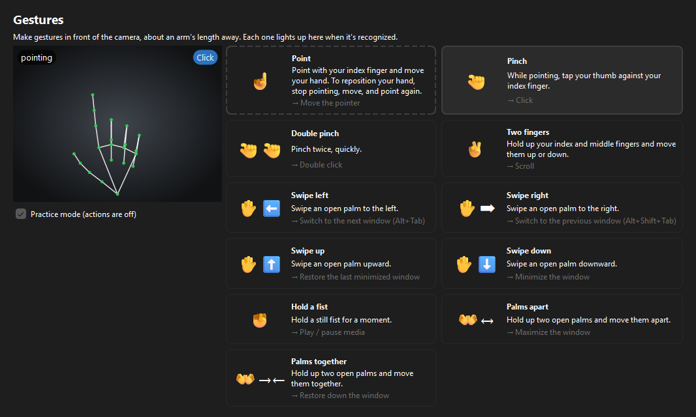
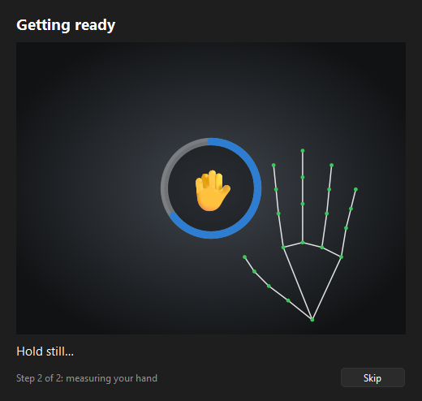
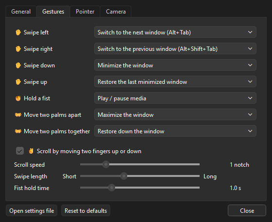

<div align="center">

# HandGestures

**CONTROL WINDOWS WITH YOUR HANDS.**

Point to move the pointer, pinch to click, swipe to switch and arrange windows, hold a fist to
pause the music. HandGestures turns hand gestures in front of your webcam into Windows commands.
Hand tracking runs on your PC, so it works offline and the camera image never leaves your computer.

**[Download the latest release](https://github.com/S11mk3/HandGestures/releases/latest)** ·
[Website and patch notes](https://andrijasimic.vercel.app/handgestures.html)



</div>

---

## Install

Download `HandGestures-Setup-<version>.exe` from the
[latest release](https://github.com/S11mk3/HandGestures/releases/latest) and run it.

- **You need:** Windows 10 or 11 (64-bit) and a webcam, built-in or USB.
- **No administrator rights.** It installs just for you, under `%LOCALAPPDATA%\Programs`.
- **No internet.** The hand-tracking model ships inside the installer.
- **Start at sign-in** is a checkbox during setup. It then starts in the tray without the camera
  preview. You can change it later in Settings.

> **"Windows protected your PC"?** Click **More info → Run anyway**. HandGestures isn't signed
> with a paid code-signing certificate, and Windows shows that warning for every unsigned
> program from a publisher it hasn't seen before.

**Updating:** run the new setup file. It asks you to quit HandGestures first, and keeps your
settings and calibration.
**Uninstalling:** in Windows, *Settings → Apps → Installed apps → HandGestures*. It asks whether
to delete your settings and log too.

## First start



1. **Calibration.** HandGestures checks your lighting, then asks you to hold up an open hand for
   a moment. That tunes the gestures to your hand, your camera and your distance from it, and
   picks how much to smooth the pointer for your camera. It takes about 5 seconds. You can skip
   it, which reuses your last calibration, or turn it off in Settings.
2. **Gesture guide.** Then the guide opens with every gesture. It starts in **practice mode**:
   gestures light up when they're recognized, but nothing happens on your PC, so you can try
   them safely.
3. **The tray icon.** HandGestures lives in the system tray. Click the icon to pause or resume.
   Right-click it for the camera preview, Recalibrate, Settings, the gesture guide and Quit.
   Its color shows what it's doing:
   🟢 running · ⚪ paused · 🔵 calibrating · 🟠 something needs your attention (it also shows
   a notification saying what).

<br clear="right">

## Gestures

| Gesture | Default action |
|---|---|
| ☝ Point with your index finger and move your hand | Move the pointer |
| 🤏 While pointing, pinch thumb and index finger | Click |
| 🤏🤏 Pinch twice quickly | Double click |
| ✌ Move two fingers up or down | Scroll |
| ✋ Swipe an open palm left / right | Switch to the next / previous window (Alt+Tab / Alt+Shift+Tab) |
| ✋ Swipe an open palm down / up | Minimize the window / restore the last minimized one |
| ✊ Hold a still fist for a second | Play / pause media |
| 👐 Move two open palms apart / together | Maximize / restore down the window |

**Make them your own.** The swipes, the fist and the two-palm gestures can each do something
else: show the desktop, open Task view, change tracks, mute, turn the volume up or down, go back
or forward in the browser and File Explorer, or nothing at all. Choose in **Settings → Gestures**.
Pointing and scrolling can be switched off there too.

**The pointer** moves like a finger on a touchpad: by how far your hand moves, from wherever the
pointer already is, so it never jumps when you start pointing. Move quickly to cross the screen,
slowly for pixel precision. To reposition your hand without moving the pointer, stop pointing,
move, and point again. A click lands where the pointer was before you started pinching, and the
pointer works across all your monitors.

**Swipes** have to be quick and deliberate, under half a second. How far they must go follows
how big your hand looks to the camera, so gestures feel the same close up and far away. After
each gesture HandGestures waits a moment, so one movement never fires two commands.

## Settings



Right-click the tray icon and choose **Settings**. Changes apply immediately, with no restart.

- **General:** start at sign-in, calibrate at every start, show the camera preview at start,
  battery saver, and the gesture guide.
- **Gestures:** what each gesture does, scroll speed, swipe length, fist hold time.
- **Pointer:** speed, acceleration, smoothing, and how firmly you must pinch to click.
- **Camera:** which webcam to use, recalibrate, tracking details on the preview.

Settings, calibration and the log are kept in `%LOCALAPPDATA%\HandGestures`. The tray menu
opens that folder.

**Battery saver** (on by default): after 5 seconds with no hand in view, HandGestures looks for
one 8 times a second instead of in every frame, and even less often while paused.

<br clear="right">

## Tips for reliable tracking

- **Light:** face a window or lamp. Bright light *behind* you turns your hand into a silhouette.
  HandGestures brightens a dim picture by itself, and calibration tells you when the light is a
  problem.
- **Distance:** about an arm's length from the camera works best, with your whole hand in view.
- **Clear gestures:** hold poses clearly. A swipe is a quick, deliberate sweep, not a drift.
- **Pause it** from the tray while you're not using it, so a stray movement doesn't count.

## Troubleshooting

| Problem | Try |
|---|---|
| "The camera picture is black" | Open the webcam's privacy shutter, or press the laptop's camera key. |
| "Can't use camera" | Close other apps using the camera (video calls), or pick another camera in Settings. It keeps retrying by itself. |
| Gestures trigger by accident | Pause from the tray while you're not using it, or set that gesture to *Do nothing* in Settings. |
| The pointer is jittery | Move **Smoothing** toward *Steady* in Settings → Pointer, or add light and recalibrate. |
| Clicks don't register | Move **Pinch to click** toward *Light*. |
| Nothing happens in some apps | Windows blocks input to apps running as administrator, unless HandGestures runs as administrator too. |
| Starting it again does nothing | It's already running: the second start opens its Settings. Look for the icon in the tray (it may be under the **^** arrow). |

The log (`handgestures.log`, in the folder above) records what was recognized and any errors.

## Privacy

HandGestures has no network features. Each camera frame is processed in memory and then
discarded. Nothing is stored or sent anywhere. Calibration saves only measurements, such as how
big your hand looks to the camera, never an image.

## What's new

The current version is **1.1.2 (beta)**. It adds the settings window, calibration, the gesture
guide and gestures you can rebind. Patch notes for every version, in English and Serbian, are on
the [website](https://andrijasimic.vercel.app/handgestures.html#patch-notes).

## License

HandGestures is proprietary software. You may install and use the official release on your own
computers. Copying, modifying or redistributing it, or its source code, needs the author's
written permission. See [LICENSE](LICENSE).

It is built on open-source components that keep their own licenses: MediaPipe, OpenCV, Qt
(PySide6) and others. See [THIRD_PARTY_NOTICES.md](THIRD_PARTY_NOTICES.md).

---

## Development

Needs Python 3.11+ (tested with 3.13) on Windows.

```
python -m venv .venv
.venv\Scripts\pip install --no-cache-dir -r requirements-dev.txt
.venv\Scripts\python main.py
```

Options: `--dry-run` (log gestures without acting on them), `--no-preview`, `--no-calibration`,
`--verbose`. Running from source keeps settings and the log in the project folder. The hand model
is downloaded on the first run.

```
.venv\Scripts\python -m pytest         # tests
.venv\Scripts\python -m ruff check .   # lint
```

Both run on every push to `main` (GitHub Actions, [`ci.yml`](.github/workflows/ci.yml)). The
tests use synthetic hands, so they need no camera.

**Build the installer** (needs [Inno Setup 6](https://jrsoftware.org/isinfo.php):
`winget install JRSoftware.InnoSetup`):

```
powershell -ExecutionPolicy Bypass -File installer\build.ps1
```

This runs the tests, bundles the app with PyInstaller and creates
`dist\HandGestures-Setup-<version>.exe`. The version comes from `__version__` in
`handgestures\__init__.py`. Pushing a tag that matches it, such as `v1.1.2`, builds the
installer on GitHub Actions and attaches it to a release
([`release.yml`](.github/workflows/release.yml)).

### Project layout

```
main.py                    entry point (the installer bundles this)
handgestures/
  app.py                   starts the app: tray, windows, camera thread
  tracking_loop.py         camera frame → hands → gestures → actions; battery saver, reconnecting
  camera.py                reads the webcam, keeping only the newest frame
  image_tuning.py          judges the lighting, brightens dim pictures
  calibration.py           the light check and hand measurement at start
  hand_tracker.py          finds hands in a frame (MediaPipe)
  hand_landmarks.py        the 21 points of a hand
  hand_poses.py            finger bends → pose; the hand's size in the frame
  gesture_detector.py      sends each frame to the one- or two-hand gestures
  one_hand_gestures.py     swipes, fist hold, scroll, pointing
  pointer_gestures.py      pointer position and pinch clicks
  two_hand_gestures.py     palms apart / together
  cursor_motion.py         hand movement → cursor movement, with acceleration
  pointer_driver.py        moves the cursor smoothly on its own thread
  gestures.py              the gestures, and their cooldown
  bindings.py              the actions gestures can be bound to
  actions.py               performs actions in Windows
  windows_input.py         synthesized keyboard and mouse input
  autostart.py             start at sign-in
  config.py                settings, their validation, and live changes
  ui/                      tray icon, preview, calibration, settings and guide windows (Qt)
tests/                     unit tests, with synthetic hands
tools/                     icon and license helpers for the build
installer/                 PyInstaller spec, Inno Setup script, build script
docs/                      screenshots for this README
```
